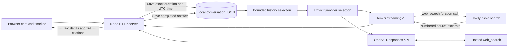

# Minimi: architecture and trade-offs

## Objective

Answer accurately with low perceived latency while remembering what the user asked and when. Both provider configurations expose **exactly one model tool, `web_search`**. Persistence and deterministic memory selection are host application logic, not additional tools.

The default setup uses free-tier-capable **Gemini 3.5 Flash-Lite + Tavily Search**. OpenAI Responses with hosted web search remains an optional paid configuration. The deliverable is a local, single-user app and public source repository, not a production multi-tenant service or a guarantee of factual accuracy.

## Architecture

Node 20.12+ provides HTTP, fetch, streams, UUIDs, filesystem operations, testing, and `.env` loading. There are **zero npm dependencies** and no build step. The browser UI is plain HTML/CSS/JavaScript. Provider selection is explicit with `AI_PROVIDER`; if unset, a configured Gemini key takes precedence, otherwise OpenAI is selected. Missing keys and quota errors never trigger a provider fallback.

### Turn lifecycle

1. Validate Host, Origin, request size, message length, and search mode.
2. Lock the conversation in process. Reject concurrent turns in the same conversation with HTTP 409; permit at most four independent active turns.
3. Save the question with its server-generated UTC timestamp before contacting a provider.
4. Select history and supply current time, conversation timezone, original timestamps, and the number of selected versus total messages.
5. Stream text through a newline-delimited JSON connection to the browser. In Gemini mode, execute only validated `web_search` requests and return bounded source excerpts; in OpenAI mode, the provider executes hosted search.
6. Save only a completed answer with its citations and measured timings. Interrupted, truncated, and failed responses are not saved as successful answers.
7. Retain failed questions in the timeline, release the lock, and restore the question in the composer for explicit retry.

## Memory design

### Durable records

Each conversation lives in `DATA_DIR/<UUID>.json` with its ID, title, original IANA timezone, creation time, and ordered messages. Each message contains an ID, role, exact content, and ISO 8601 UTC timestamp with milliseconds. Assistant records include citation URLs/offsets, search count, first-text latency, and total duration.

The browser displays times in its viewing timezone. Hovering a timestamp or exporting the conversation reveals exact UTC. The model receives the conversation's original timezone for interpreting relative dates. A live test caught self-referential recall; instructions now explicitly distinguish the current recall question from the preceding user question, and Gemini records label current versus earlier messages.

Writes use a temporary file and rename so normal readers do not observe partially written JSON. This is not a write-ahead log or a power-loss durability guarantee. Parse errors are reported rather than silently resetting data. One server process must own a data directory. Full-file writes and in-process locks suit personal usage; migrate to SQLite transactions and indexed retrieval when volume or concurrency warrants it.

### Automatic context selection

The application selects history with a 48,000-character content budget, including a per-record allowance:

1. Admit the most recent 16 messages, with newest messages taking priority.
2. Tokenize the current question using Unicode letters/numbers and discard generic stop words.
3. Rank older messages by matching query terms in their content and timestamps. Admit up to 12 matching records and neighboring exchanges, budget permitting.
4. Admit opening context if space remains, deduplicate, then restore chronological order.

Failed turns remain inspectable but are excluded from model context to avoid replaying interrupted requests. Full text remains on disk; no model-generated summary rewrites the record. The complete question timeline and JSON export are independent of the model's selected context. New conversations are isolated, including when switching providers.

### Recall limits

Lexical retrieval can miss synonyms, indirect references, and complex date queries outside the recent window. The content budget is measured in characters, not exact tokens, and does not include provider-internal reasoning or search context. The prompt requires admitting omitted history rather than claiming exhaustive recall. Semantic retrieval could improve recall but would add inference cost, dependencies, and processing of sensitive history.

## Search and citations

Automatic mode asks the model to search for current/changeable facts, uncertain or niche claims, and explicit verification. Greetings, rewriting supplied content, basic reasoning, and personal-history recall should skip search. This remains a model decision, not a guarantee; **Always search** forces an initial tool call and **No search** disables tools for that turn.

### Gemini + Tavily

The model sees one function declaration: `web_search(query)`. The host validates the function name and query, permits at most three searches and four model requests per turn, and rejects any other tool. Function-call thought signatures and IDs are preserved when returning results. `ANY`, `AUTO`, and `NONE` function-calling modes implement the search controls; execution also enforces them independently of the model.

Tavily receives only the selected search query. The request explicitly uses `search_depth: basic`, `auto_parameters: false`, five results, and no generated answer or raw HTML. Each result is limited to a 3,000-character excerpt, a title, and an HTTP(S) URL. The host supplies numeric source IDs; the model cites `[1]`, `[2]`, etc. Only IDs corresponding to actual returned sources become clickable links. A searched answer with available sources but no valid citations is rejected. This validates source identity, not entailment: a citation can still fail to support a claim.

An optional `TAVILY_API_KEY` uses the user's account. Without it, the app requests the documented free keyless mode. Rate-limit errors stop the turn with instructions to wait or add a free key; there is no hidden retry or paid fallback. The app uses **Search only**, not Tavily Extract, Crawl, or Research.

### OpenAI

One streamed Responses request exposes only the hosted `web_search` tool, with medium search context, low reasoning effort, `max_tool_calls: 3`, and `store: false`. Automatic/required/none tool selection implements the same search controls. Final URL citation annotations are preserved and rendered as links. Provider-hosted search may internally open pages; those are operations within the same registered tool.

### Accuracy policy

Instructions prefer authoritative original sources, distinguish publication and event dates, request corroboration for disputed or consequential claims, and prohibit invented sources. Search content is untrusted evidence, never an instruction source. The agent is asked not to send private conversation facts to search unless needed for explicit research. Prompt instructions are not a formal prompt-injection defense or data-loss-prevention system.

## Free-tier choices and technical trade-offs

As checked November 15, 2026, Google lists free input/output for Gemini 3.5 Flash-Lite, subject to project limits. Newer Gemini models' built-in Google Search is not available on that free tier. The older Gemini 2.5 Flash-Lite advertises free grounding, but a live request rejected the configured key because that model is unavailable to new users. Hence the newer model plus a separate free search service.

Tavily's free account includes 1,000 credits/month, and basic search costs one credit. Thus 1,000 credits is not necessarily 1,000 conversation turns: one turn may use zero to three searches. Keyless search is free but rate-limited; it returned HTTP 429 in this environment, so a free Tavily key was added for the successful live test.

The app cannot inspect billing settings. A paid Google or Tavily account can incur usage charges; free-tier-capable code does not force an account onto a free plan. The app does not enroll users in billing, upgrade accounts, rotate keys to evade quotas, or silently switch providers.

### Latency and bounds

- OpenAI uses one inference request; Gemini usually uses one for chat or two for a single search, with at most four model rounds. This extra round trip is the main cost of using an independent free search API.
- Streaming reduces perceived latency; the UI reports first-text and total time separately. Intermediate model text can appear before a tool call; only the final round is saved as the answer.
- One 90-second deadline covers the Gemini loop and search calls. Each model response has a 5,000-output-token cap; this is per round, not an aggregate token budget. Messages are limited to 8,000 characters.
- No answer cache avoids stale current facts and conversation-dependent cache leaks. No hidden retry avoids duplicate costs after partially received streams.

## Security and privacy

The server binds only to `127.0.0.1`. Host, Origin, and Fetch Metadata checks reduce local DNS-rebinding and cross-site access risks, but are not user authentication. UUID validation prevents path traversal. Requests and excerpts are bounded; raw provider error bodies are not shown in the UI.

Keys stay in the server environment. `.env`, history, logs, and artifacts are excluded from Git. The UI creates text nodes and safe HTTP(S) links rather than rendering model HTML. A restrictive Content Security Policy blocks external/inline scripts, framing, and unsafe base URLs.

Local records are plaintext. Selected history is transmitted to the selected model provider; in Gemini mode, public queries go to Tavily and returned excerpts go to Google. Google's free tier may use content to improve its products. OpenAI `store: false` disables Responses application storage, not all provider processing or retention. Local deletion does not erase backups or provider logs.

A public hosted deployment first needs authentication, per-user authorization, encrypted durable storage, distributed concurrency, rate limits, TLS, monitoring, and a retention policy. Do not simply change the bind address.

## Verification

`npm test` contains 20 offline tests covering persistence, exact timestamps, isolation, bounded older-memory retrieval, tool restrictions, search modes, Unicode/chunked SSE, citations, provider selection, thought-signature preservation, search budgets, quotas, truncation, concurrency, input validation, and local-origin protections. Mocked tests validate application logic, not model truthfulness. GitHub Actions runs Windows/Linux on Node 20/22.

`npm run test:live` requires actual provider access. It searches NASA for the Apollo 11 landing date, requires a search and citation, reloads the conversation from disk, and checks exact timestamp recall with search disabled. `--memory-only` checks recall without search.

On November 15, 2026, Gemini 3.5 Flash-Lite plus a Tavily key passed the complete live check: a sourced July 20, 1969 answer took about 4.2 seconds; exact prior-question/UTC timestamp recall after reloading took about 1.7 seconds with zero searches. These are individual smoke-test samples, not a general performance or accuracy benchmark. OpenAI validation remains blocked by exhausted credits on the configured account.

A broader evaluation should measure current-fact correctness, conflicting sources, false premises, citation relevance, long-history paraphrases, timezone-midnight boundaries, injected source instructions, first-text/total p50/p95 latency, and cost per successful answer. No such benchmark results are claimed.

## Official references

- [Gemini pricing](https://ai.google.dev/gemini-api/docs/pricing#gemini-3.5-flash-lite)
- [Gemini streaming API](https://aistudio.google.com/api-reference/generate-content/stream-generate-content)
- [Tavily Search API](https://docs.tavily.com/documentation/api-reference/endpoint/search)
- [Tavily credits](https://docs.tavily.com/documentation/api-credits)
- [Tavily keyless access](https://docs.tavily.com/documentation/keyless)
- [OpenAI web search](https://developers.openai.com/api/docs/guides/tools-web-search)
- [OpenAI streaming events](https://developers.openai.com/api/reference/resources/responses/streaming-events)

Consulted November 15, 2026; availability and limits can change.
